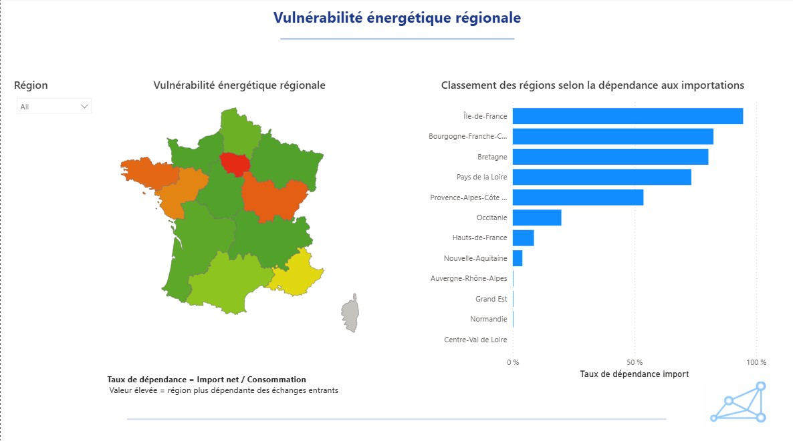

# Analyse du mix énergétique en France (2013–2023)

## Objectif du projet

Analyser l’évolution de la production et de la consommation d’électricité en France, à partir de données régionales, afin d’identifier les disparités territoriales, les périodes de forte consommation et les niveaux d’autonomie énergétique.

## Outils et technologies

Python : pandas, NumPy, nettoyage et préparation des données

Analyse exploratoire : statistiques descriptives et identification des tendances

Power BI : visualisations interactives, cartes et indicateurs clés de performance (KPI)

## Démarche d’analyse

Exploration et compréhension des données

Nettoyage et préparation du jeu de données

Analyse de la production et de la consommation régionales

Calcul et comparaison des indicateurs énergétiques

Création de visualisations et de tableaux de bord interactifs

## Axes d’analyse

Évolution de la production et de la consommation d’électricité

Comparaison des situations énergétiques entre régions

Analyse de l’autonomie énergétique régionale

Identification des variations saisonnières et des pics de consommation

## Compétences mobilisées

Python · pandas · Analyse de données · Statistiques descriptives · Power BI · Data Visualization · KPI

👤 Auteur:

Mohamed Lamine Camara
Data Analyst | Ingénieur SIG / Géomaticien

Mon profil LinkedIn: Mohamed Lamine CAMARA · Mon profil GitHub: mlamine-camara

## 📊 Visualisations du projet

### Mix énergétique

### Autonomie énergétique régionale

### Vulnérabilité énergétique régionale

